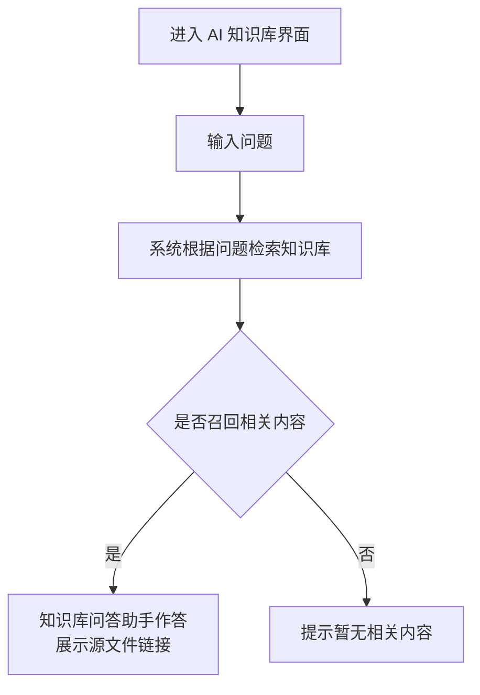
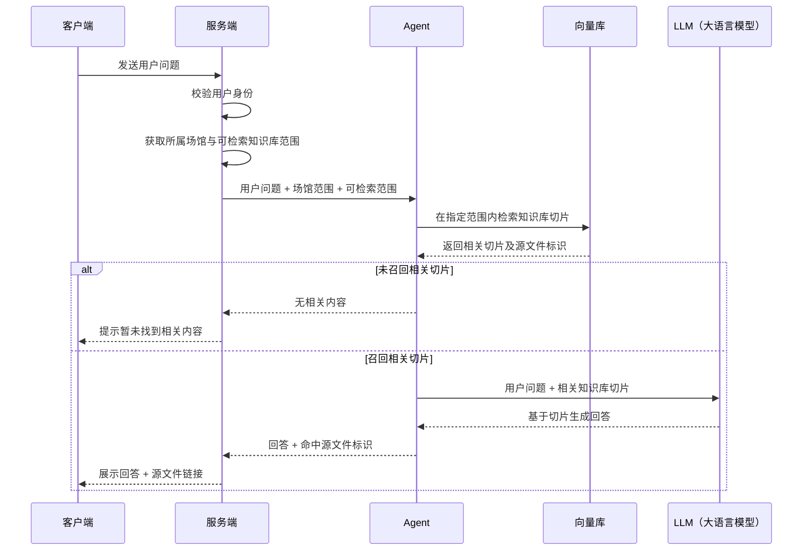

# 20261009

## 内容概览

本期做最小闭环逻辑，让 ai 知识库及 agent 助手以最快速度上线，给用户打出概念，
鼓励用户尝试并获取用户反馈，收集建议。
故 本期内容中只包含主干逻辑，及提问-得到结果。所有辅助功能放到后续迭代。
## 背景与目标

### 产品背景

场馆制度、销售策略等内容分散在多份资料中。
员工需要快速获得可核对的信息。

知识库已承担资料上传、内容处理和可见范围管理。
手机端需要提供面向使用人员的对话式查询入口，将已可用且当前用户有权查看的知识库内容转化为可阅读的回答。

### 产品目标

- 让员工可在手机端通过自然语言快速查询知识库内容。
- 让回答展示可追溯的来源资料，便于员工核对依据。
- 让知识库问答助手基于切片数据生成有依据的回答，并提供对应源文件链接。

### 目标用户
场馆内的各类工作人员。

## 业务流程与页面功能

### 业务流程

### 页面功能

| 名称    | 类型       | 展示信息               | 核心交互          |
| ----- | -------- | ------------------ | ------------- |
| 对话界面  | 页面 对话 | 引导语： 前往电脑端上传知识库 | 输入并发送问题    |
| 资料引用  | 弹窗 抽屉 | 源文件名称 命中的切片及内容  | 关闭抽屉 查看源文件 |
| 源文件预览 | 页面 预览 | 源文件完整内容            | 返回对话界面        |
原型链接：
https://liboom666.github.io/ai-knowledge-base-demo/%E6%89%8B%E6%9C%BA%E7%AB%AFAI%E7%9F%A5%E8%AF%86%E5%BA%93%E5%AF%B9%E8%AF%9D%E6%BC%94%E7%A4%BA-%E9%9C%80%E6%B1%82%E5%AF%B9%E9%BD%90%E7%89%88.html

## 功能详情

### 对话界面

#### 界面交互

**引导语展示**
	本期存在场景，用户第一次点开手机 app 里的知识库 agent，还没有任何文件，所以需要提供引导，让用户前往电脑端上传知识内容。
	==🟡这里运营可以介入看下怎么在第一眼看到的位置给出赠送的概念，引导用户体验。==

引导语（暂用）：
	菠菜已免费为您的场馆开通知识库体验功能，包含 200MB 知识库存储空间和 50 次问答体验次数。  请先前往电脑端上传知识库文件，完成后即可在手机端进行知识库问答。

**信息检索**
	本期不含语音输入或语音转文字相关内容

输入框（需支持换行展示，以 ui 出的效果为准）
【发送】——按钮，需要输入键盘回车同样支持发送。

**agent 状态和判断逻辑**

状态：
	思考——用户发送内容后进入思考，展示对应动效
	回复——ai 生成回复内容后，进行展示
	（后期需要流式效果和对话转语音等辅助能力，本期只用最简单的方式把回复内容展示出来。）

判断逻辑：

#### 边缘场景

问题为空或仅包含空格时，不发起检索。

未召回相关内容时，展示
“根据您的问题，暂未找到相关内容，请前往电脑端上传相关文件。”

**通讯异常处理**

| 异常位置                                  | 用户可见反馈                 | 交互              |
| ------------------------------------- | ---------------------- | --------------- |
| 客户端与服务端通讯失败 或服务端返回结果时通讯中断 等通讯问题 | “网络连接异常， 请检查网络后重试。” | 保留用户问题； 重试按钮 |
| 服务端调用 Agent、 向量库或 LLM（大语言模型）失败     | “服务暂时不可用， 请稍后重试。”   | 保留用户问题； 重试按钮 |

### 资料引用

#### 界面交互

用户点击对话界面中的源文件链接后，从页面底部打开资料引用抽屉。

抽屉展示：
	源文件名称
	当前回答相关的引用片段。

交互：
	关闭
	【查看源文件】，进入“源文件预览”页面。

### 源文件预览

#### 界面交互

页面展示用户从资料引用抽屉打开的源文件完整内容。

用户可返回对话界面，继续当前问题的查看或提问。

