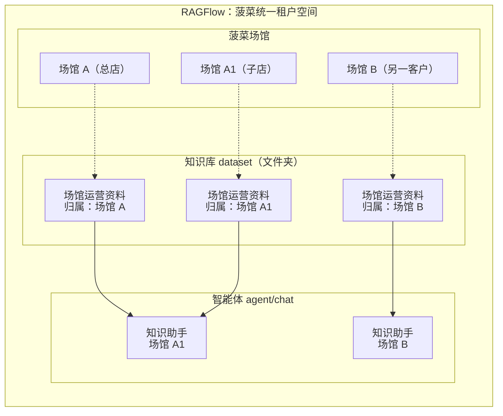

# 20261021

- **租户空间**：所有知识库统一存放在菠菜使用的一个 RAGFlow 租户空间内。
- **门店关系**：场馆 A 为总店，A1 为其子店，场馆 B 属于另一客户。
- **知识库归属**：各场馆分别拥有自己的知识库文件夹。
- **智能体使用范围**：A1 的知识助手使用 A 总店和 A1 本店的对应知识库，B 的知识助手只使用 B 本店的知识库。
- **展示范围**：图中仅展示部分知识库和智能体。

租户空间外框表示统一承载背景，场馆和智能体的排列用于说明业务关系，不表示它们都是知识库中的存储对象。

## 租户空间与门店层级
菠菜平台统一使用一个 RAGFlow（知识库引擎）租户空间，承载平台下各场馆客户的知识库资料。 
不按客户、总店或子店分别创建 RAGFlow 租户空间。

RAGFlow 租户空间用于承载知识库，不代表菠菜平台中的客户或门店组织。  
各客户及其门店的业务归属，仍由菠菜平台管理。

共用租户空间不代表不同客户或门店可以相互检索资料，基于业务层做数据隔离。

## 知识库的划分与归属

一个菠菜门店的知识库对应一个 dataset（知识库），业务上理解为一个文件夹。
每家门店独立建立若干知识库文件夹，按智能体用途区分，例如“销售助手”文件夹。
总店与各子店的知识库分别归属各自门店，资料分别存放。

使用子店的 chat （/agent 以下省略） 时，会同时查子店和总店的两个知识库。
使用总店 chat  或 单独门店的 chat 时，只查本门店的知识库

## 智能体配置与知识库挂载

agent/chat（智能体）指预先配置好的智能体助手，同店员工共用同一个智能体及其知识库配置。
	不同门店的同名智能体使用相同提示词，知识库按各自门店分别配置。

chat 和知识库空间的对应关系
	每个 chat 对应多个知识库（dataset）
	chat 和知识库的配置关系固定，不允许用户自行更改 chat 关联的知识库。
		用户只在对应知识库内做内容的上传。

举例：
	场馆 A（总店）和场馆 A1（子店）都启用了“场馆运营资料”agent
		则在知识库层面，会有两个 ——datasetA（场馆运营资料），datasetA1（场馆运营资料）
		场馆 A1（子店）的工作人员，使用 chat-场馆运营资料时 ，chat 调用的知识库是 datasetA 和 datasetA1
		场馆 A（总店）的工作人员，使用 chat...时，调用的是，datasetA。
			即，子店的 chat 同时包含子店和总店的信息。
			此场景通过业务层做逻辑，通过 ragflow 的 chat 配置关联知识库。

## 会话与智能体的关系

session（会话）指员工使用已配置好的智能体时，每次新建的一段对话。
	新建会话不会创建新的智能体或知识库，也不改变既有知识库挂载关系，只是使用一个 chat 创建一组对话内容，它具备自己的对话标题。

后续使用情况 统计分析等，可以根据 seesion 的信息做。

## 表结构参考

以下为业务表结构的逻辑思路，暂不展开完整字段及字段类型。
场馆表及场馆总子店关系表优先复用现有业务表。

| 表 | 用途 | 主要记录内容 | 关联关系 |
| --- | --- | --- | --- |
| 场馆表 | 记录总店、子店的基础信息 | 场馆编号、场馆名称等基础信息。 | 总店和子店都作为场馆记录。 一家场馆可以拥有多个知识库和智能体。 |
| 场馆总子店关系表 | 记录总店与子店的归属关系 | 总店场馆编号、子店场馆编号。 | 两个编号均关联场馆表。 用于确定子店所属总店。 |
| 知识库表 | 记录各门店的知识库文件夹 | 知识库编号、名称、所属场馆编号、对应的 RAGFlow dataset（知识库）编号。 | 每个知识库归属一家场馆。 同一个知识库可以被多个智能体配置使用。 |
| 智能体表 | 记录各门店的智能体及知识库配置 | 智能体编号、名称、所属场馆编号、对应的 RAGFlow agent/chat（智能体）编号、关联知识库编号列表。 | 一个智能体可以关联多个知识库。 同店员工共用对应智能体。 |
| 对话会话表 | 记录员工基于智能体建立的对话 | 会话编号、所属智能体编号、发起员工编号、对应的 RAGFlow session（会话）编号。 | 一个智能体可以关联多个会话。 每个会话记录发起员工。 |

## 初始化逻辑

初始化——（配置知识库空间+chat/agent）
	以智能体维度（一次创建一个智能体）
		每个智能体开发时有一套模板（知识库空间+chat/agent 配置+工具）
		指定门店开启某个智能体时，根据模板进行自动化配置。
